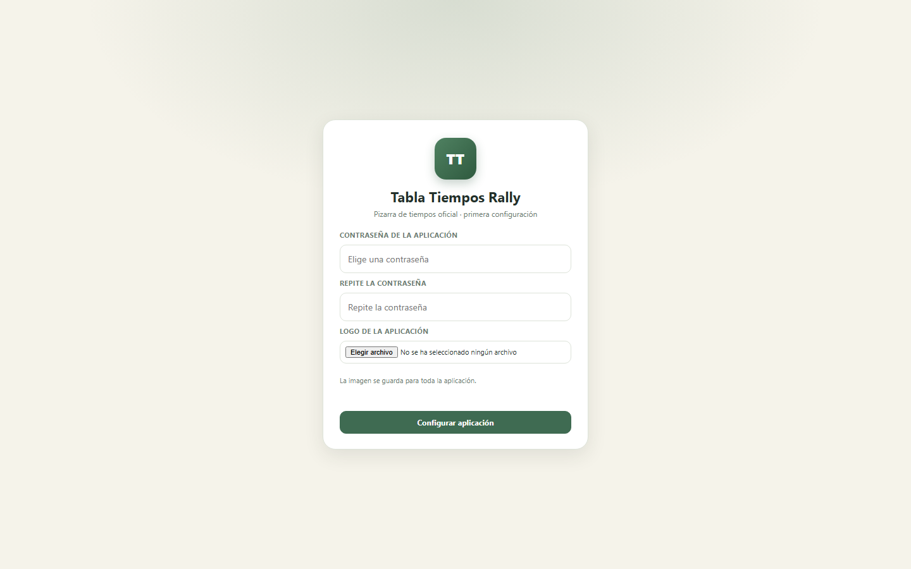

<h1 align="center">Tabla Tiempos Rally</h1>

<p align="center">
  Lleva los tiempos de un rally de Assetto Corsa en directo, sin Excel ni Skype.
</p>

<p align="center">
  
  
  
  
  
  
</p>

<p align="center">
  <a href="https://github.com/adrianllorian/TablaTiemposRally/releases/latest/download/tabla-tiempos-1.0.0.jar">
    
  </a>
</p>

<p align="center">
  <strong>Java 21+ · 70 MB · Windows / Linux / macOS</strong>
</p>

---

## Vista previa

<p align="center">
  
</p>

## Características

- **Un único rally activo** y un historial con todos los rallies anteriores.
- **Tabla en vivo** mediante SSE: los cambios aparecen sin recargar.
- **Clasificación automática** por tiempo total, con `EC` (en curso) y retirados al final.
- **Tramos**: tiempos válidos, penalizaciones y retiradas.
- **Penalizaciones dinámicas**: peor tiempo válido del tramo + X (30 s por defecto) o tiempo fijo.
- **Colores automáticos**:
  - morado: mejor tiempo válido del tramo,
  - verde: tiempo válido,
  - rojo: penalización,
  - gris: en curso, retirado o tramo anulado,
  - corona: récord histórico.
- **Récords por nombre de tramo**, no por `TC-x`, con top 5, buscador y actualización en vivo.
- **Shakedown opcional** con nombre: entra en récords, pero no suma al rally.
- **Diferencias** con el líder y con el piloto anterior, con referencia de posición y nombre.
- **Reloj y cuenta atrás de 20 s** sincronizados con el reloj real.
- **Enlace de invitado** por rally, de solo lectura, sin contraseña.
- **Exportación a Excel** con clasificación, colores y hoja de récords.
- **Configuración inicial** en el primer arranque: contraseña y logo de la aplicación.
- **Tema claro y oscuro**, diseño responsive y aviso de reconexión.
- **Sin PWA**, sin instalación y sin tooltips: todo se ve en la tabla.

## Descarga

Descarga siempre la última versión desde este enlace fijo:

**[Tabla Tiempos Rally (última versión)](https://github.com/adrianllorian/TablaTiemposRally/releases/latest/download/tabla-tiempos-1.0.0.jar)**

- Archivo: `tabla-tiempos-1.0.0.jar`
- Tamaño: 70,3 MB
- Requisito: **Java 21 o superior**
- Plataforma: Windows, Linux y macOS
- No necesita base de datos externa: H2 va incluido.

### Verificar la descarga

SHA-256 del JAR:

```text
282A6AACF2A1B7BA24884ACB1BB4875106ABDCABAF168D993E28330806CB0C42
```

Para comprobarlo en PowerShell:

```powershell
Get-FileHash ".\tabla-tiempos-1.0.0.jar" -Algorithm SHA256
```

## Ejecutar

1. Descarga el JAR y colócalo en una carpeta donde puedas escribir, por ejemplo `TablaTiempos`.
2. Necesitas **Java 21 o superior**. Comprueba con:

```bash
java -version
```

3. Arranca desde una terminal en esa carpeta:

```bash
java -jar tabla-tiempos-1.0.0.jar
```

4. Abre en el navegador:

```text
http://localhost:8888
```

Para detener el servidor, pulsa `Ctrl + C` en la terminal.

### Primer arranque

En el primer arranque la app pide:

- la **contraseña** que se usará para entrar,
- el **logo** de la aplicación.

El logo y la contraseña se guardan para toda la aplicación. Después se pueden
cambiar en `Configuración → Ajustes de la aplicación`.

## Datos y copias de seguridad

La base de datos es **H2 en archivo** y se guarda en una carpeta `data`
**junto al JAR**:

```text
data/
├── tabla-tiempos.mv.db     # base de datos
└── logo/                   # logo subido desde la app
```

Si mueves el JAR, mueve también la carpeta `data`. Si mueves solo el JAR, la
aplicación creará un `data` nuevo y vacío junto a la nueva ubicación. Los datos
antiguos no se borran: siguen en la carpeta anterior.

- Para hacer una copia de seguridad, **para la aplicación** y copia la carpeta `data/`.
- Para restaurarla, deja la carpeta `data/` junto al JAR y arranca de nuevo.
- Para empezar de cero (borrar rallies, récords, contraseña y logo), para la aplicación y elimina la carpeta `data/`.
- No subas la carpeta `data/` a GitHub: contiene la contraseña cifrada, los rallies y el logo.

## Sesión

La sesión dura **30 días** por defecto y la cookie también es persistente: si
cierras y vuelves a abrir el navegador, la sesión se mantiene hasta que caduque
o pulses **Salir**. Puedes cambiarla con `SESSION_TIMEOUT`:

```powershell
$env:SESSION_TIMEOUT = "8h"
java -jar tabla-tiempos-1.0.0.jar
```

O con los dos argumentos:

```powershell
java -jar tabla-tiempos-1.0.0.jar --server.servlet.session.timeout=8h --server.servlet.session.cookie.max-age=8h
```

Valores habituales: `30m`, `2h`, `8h`, `1d`, `30d`.

## Configuración

Por defecto usa el puerto `8888`. Puedes cambiarlo al arrancar:

```bash
java -jar tabla-tiempos-1.0.0.jar --server.port=9090
```

También se puede fijar en `backend/src/main/resources/application.properties` si compilas desde el código.

## Compartir con los participantes

### En la misma red local

1. Averigua la IP local del equipo que ejecuta el servidor.
2. Abre el puerto `8888` en el cortafuegos de Windows.
3. Comparte:

```text
http://IP_DEL_SERVIDOR:8888
```

### Por internet

Para que funcione fuera de casa, publica el puerto mediante un proxy inverso con
**HTTPS** (Caddy, Nginx, Cloudflare Tunnel, etc.). No expongas el puerto `8888`
directamente a internet sin HTTPS.

Dentro de la app, el botón **Invitar** genera un enlace de solo lectura para ese rally:

```text
https://tu-dominio/#/ver/TOKEN
```

Quien lo abra verá la tabla en directo, sin contraseña, sin configuración, sin
historial y sin récords.

## Cómo funciona

- El **frontend Angular** se sirve desde el propio Spring Boot en producción.
- El backend expone una API REST protegida por sesión.
- La tabla se actualiza por **SSE** (`/api/rallies/{id}/events`): al guardar un tiempo, el servidor recalcula la clasificación y envía la vista completa a todos los clientes conectados.
- Los cálculos de tiempos, penalizaciones, diferencias, colores, récords y estados se hacen **en el servidor**.
- La contraseña se guarda como hash **BCrypt**; nunca se guarda en texto plano ni se envía al frontend.
- El **logo** se guarda en `data/logo/` y se sirve desde `/api/public/logo`.
- El **enlace de invitado** usa un token aleatorio por rally y solo permite lectura.

## Compilar desde el código

Requisitos:

- **JDK 21**.
- **Node.js 22 o superior** y npm.
- Git.

El JAR incluye el frontend compilado dentro de `backend/src/main/resources/static`,
de modo que un solo archivo sirve toda la aplicación.

### 1. Compilar el frontend

```bash
cd frontend
npm ci
npm run build
```

El resultado queda en `frontend/dist/frontend/browser`.

### 2. Copiarlo al backend

Windows (PowerShell):

```powershell
Remove-Item -Recurse -Force backend/src/main/resources/static/*
Copy-Item -Recurse -Force frontend/dist/frontend/browser/* backend/src/main/resources/static/
```

Linux / macOS:

```bash
rm -rf backend/src/main/resources/static/*
cp -R frontend/dist/frontend/browser/. backend/src/main/resources/static/
```

### 3. Empaquetar

```bash
cd backend
./mvnw -DskipTests package
```

Windows:

```powershell
.\mvnw.cmd -DskipTests package
```

El JAR se genera en `backend/target/tabla-tiempos-1.0.0.jar` y se ejecuta igual que el descargado:

```bash
java -jar backend/target/tabla-tiempos-1.0.0.jar
```

### Publicar una release

1. Compila el JAR definitivo y pruébalo.
2. Crea el tag de la versión:

```bash
git tag v1.0.0
git push origin v1.0.0
```

3. En GitHub, entra en **Releases → Draft a new release**, selecciona el tag y adjunta el JAR.
4. Publica la release.

No hagas `git add` del JAR: cada compilación añade unos 70 MB al historial del repositorio.

## Estructura del proyecto

```text
TablaTiemposRally/
├── backend/                  # Spring Boot
│   ├── src/main/java/        # dominio, servicios, controladores, SSE
│   ├── src/main/resources/
│   │   ├── application.properties
│   │   └── static/           # frontend compilado que sirve el JAR
│   ├── mvnw / mvnw.cmd
│   └── pom.xml
├── frontend/                 # Angular
│   ├── src/app/              # componentes, servicios, modelos y pipes
│   ├── src/styles.css
│   ├── proxy.conf.json
│   └── package.json
├── docs/screenshot.png
├── mockup/index.html
├── LICENSE
└── README.md
```

## Tecnologías

| Capa | Tecnología |
| --- | --- |
| Frontend | Angular 22 (standalone components, signals) |
| Backend | Spring Boot 4.1.2, Java 21 |
| Base de datos | H2 en archivo |
| Tiempo real | Server-Sent Events (SSE) |
| Autenticación | Sesión con cookie HttpOnly + BCrypt |
| Exportación | Apache POI (`.xlsx`) |
| Build | Maven Wrapper + Angular CLI |

## Seguridad

- Contraseña con hash BCrypt y sesión con cookie `HttpOnly`.
- No se versionan la base de datos, los rallies, el logo ni la contraseña.
- Para exponerlo fuera de la red local, usa un proxy inverso con HTTPS.

## Licencia

Distribuido bajo **MIT License**. Consulta [LICENSE](LICENSE).

---

<p align="center">
  Copyright © 2026 Adrian Llorian
</p>
